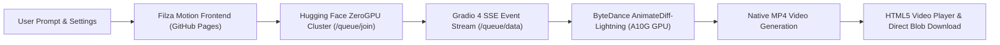

# Filza Motion AI — Free AI Text-to-Video Generator

> **Next-Generation Free AI Text-to-Video Engine**  
> Generate fluid, cinematic AI videos directly in your browser without accounts, subscriptions, credit cards, or API keys.

[](LICENSE)
[-06B6D4.svg)](#architecture)
[](https://huggingface.co/ByteDance/AnimateDiff-Lightning)
[-10B981.svg)](https://huggingface.co/docs/hub/spaces-gpus#zerogpu)

---

## 1. Project Overview

**Filza Motion AI** is a free, public, static web application that generates genuine MP4 AI videos from text descriptions. It runs entirely on the client side, hosted on GitHub Pages, and connects directly to publicly accessible AI inference infrastructure running **ByteDance AnimateDiff-Lightning** on **Hugging Face ZeroGPU** clusters.

### Key Highlights
- **100% Free & Keyless**: Anyone can visit the site and generate videos immediately. No user login, no signup, no email collection, and no visitor API keys.
- **Genuine AI Video Generation**: Never displays mock or fake videos. Connects live to a distributed GPU cluster to run deep diffusion inference.
- **Direct MP4 Download**: Download your generated video as an H.264 MP4 file directly to your device with a single click.
- **Camera & Motion Controls**: Built-in AnimateDiff Motion LoRAs for cinematic camera dynamics (Zoom In, Zoom Out, Pan Left/Right, Tilt Up/Down, Clockwise/Counter-Clockwise Dutch Roll).
- **Dual Checkpoint Selection**: Choose between `epiCRealism` (photorealistic, cinematic depth) and `ToonYou` (stylized 3D, anime art).
- **Adjustable Quality & Speed**: Select between 1, 2, 4, or 8 denoising steps depending on your performance preference (~5s for 4 steps).
- **Real-Time Queue & Progress Streaming**: Server-Sent Events (SSE) display live queue rank, estimated wait time, diffusion step counter, and an elapsed stopwatch timer.
- **Zero Server Footprint**: No servers, databases, or analytics services to maintain or pay for.

---

## 2. Architecture & How It Works



### Module Breakdown
- `index.html`: Accessible, responsive HTML5 layout featuring the Studio, Status Monitor, Player, Prompt Gallery, and Technical Specifications.
- `styles.css`: Custom cinematic dark theme using deep charcoal (`#090A0F`), neon violet (`#8B5CF6`), and electric cyan (`#06B6D4`) with zero heavy framework bloat.
- `js/config.js`: Central configuration of models, camera motions, inference endpoints, and prompt validation limits.
- `js/validation.js`: Input sanitization, XSS mitigation, length boundary checks (3–500 characters), and prompt enhancement hints.
- `js/inference-client.js`: Asynchronous Gradio 4 SSE streaming client with `AbortController` cancellation, queue rank tracking, progress parsing, and Blob downloading.
- `js/generator.js`: State machine orchestrator coordinating jobs, stopwatch timing, status transitions, and error handling.
- `js/ui.js`: Presentation manager handling interactive controls, custom HTML5 video player, toast alerts, and example loaders.
- `js/app.js`: Application entrypoint, event bindings, keyboard shortcuts (<kbd>Ctrl+Enter</kbd>), and cluster heartbeat pings.

---

## 3. Verified AI Model & Infrastructure

| Attribute | Specification |
| :--- | :--- |
| **Model** | ByteDance AnimateDiff-Lightning (Adversarial Distillation) |
| **Checkpoints** | `epiCRealism` (Cinematic Photorealism) & `ToonYou` (3D Stylized) |
| **Camera LoRAs** | Zoom In/Out, Tilt Up/Down, Pan Left/Right, Dutch Roll |
| **Hardware** | Hugging Face ZeroGPU (NVIDIA A10G 24GB VRAM) |
| **Output Format** | MP4 Video (H.264 encoded, 512×512 resolution, loopable) |
| **Average Gen Time** | 5 to 8 seconds (at 4 denoising steps) |
| **Authentication** | None required (Free public queue access via SSE) |
| **CORS Support** | Fully supported (`Access-Control-Allow-Origin: *`) |

---

## 4. Security, Privacy & Honest Disclosures

1. **No Account / No Database**: Filza Motion does not collect emails, passwords, payment info, or personal identifiers.
2. **Client-Side Only**: Prompts and video URLs are never stored on any private server or logged into tracking services.
3. **Third-Party Processing**: Generation requests are processed on public Hugging Face ZeroGPU hardware. Technical request data (such as IP addresses) is subject to [Hugging Face's Privacy Policy](https://huggingface.co/privacy).
4. **Shared Queue**: ZeroGPU capacity is shared across the open-source community. During peak usage, jobs may queue for an additional 10–20 seconds.
5. **No Commercial Warranty**: Underlying model weights are licensed under the ByteDance OpenRail-M and CreativeML licenses for research and open community exploration.

---

## 5. Local Development & Testing

You can run and test Filza Motion locally with any simple HTTP server:

### Option A: Using Python
```bash
python -m http.server 8000
```
Then visit `http://localhost:8000` in your web browser.

### Option B: Using Node.js
```bash
npx serve .
```

### Running Automated Test Suite
To run the automated module validation and integration test suite:
```bash
node tests/run_all_tests.mjs
```

---

## 6. Deploying to GitHub Pages

### Quick Setup Steps
1. Create a repository on GitHub (e.g. `Filza_Generator` or `filza-motion`).
2. Push this codebase to the `main` branch:
   ```bash
   git add .
   git commit -m "feat: initialize Filza Motion AI generator"
   git branch -M main
   git remote add origin https://github.com/<YOUR_USERNAME>/Filza_Generator.git
   git push -u origin main
   ```
3. Enable GitHub Pages:
   - Navigate to **Repository Settings** &rarr; **Pages**.
   - Under **Build and deployment**, select **Source: GitHub Actions** (or select **Deploy from a branch** &rarr; `main` &rarr; `/ (root)`).
4. Your website will be live at:
   `https://<YOUR_USERNAME>.github.io/Filza_Generator/`

---

## 7. License

Distributed under the **MIT License**. See [`LICENSE`](LICENSE) for full details.  
Model checkpoints and LoRA weights are subject to their respective open-weights research licenses (ByteDance OpenRail-M).
